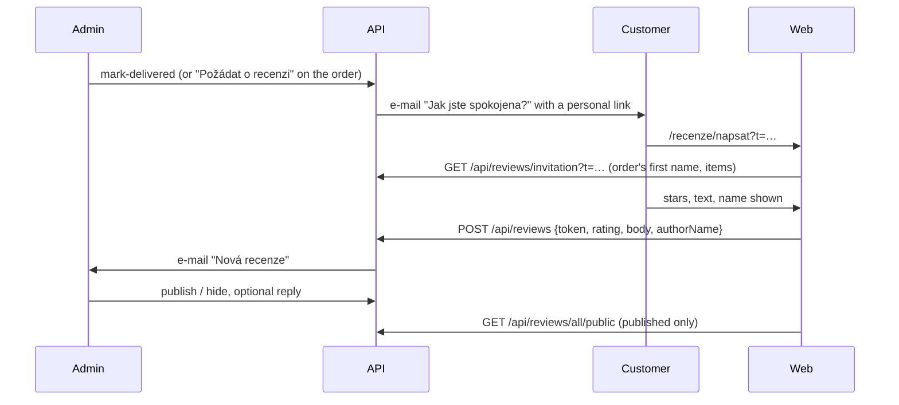

# Customer reviews in the shop

**Ticket:** none yet
**Status:** design — architecture review applied (2026-11-01), awaiting the owner's approval

The owner asked for a way for customers to leave a review in the e-shop ("navrhni možnost zanechat
recenzi v eshopu, jak to provedeš"). This is the design; nothing is implemented yet.

## What shapes it

- **Every piece is an original sold once.** A review of a product would sit on a page that is
  "prodáno" a day later and that no future customer can buy. What the next customer wants to know
  is whether the artist's work and the shop are worth trusting: how the piece looked in real life,
  how it was packed, how fast it came. So a review is of **an order** (the shop), and it names the
  pieces that order held, so it can also be shown beside the work of the same kind.
- **There are no customer accounts** (only the admin signs in, no registration), and adding them
  for reviews alone is out of proportion. Who may write a review is proven by **a personal link
  from an e-mail about the order**, which only the customer who ordered receives.
- **Czech consumer law (since 2023):** a trader who shows consumer reviews must say whether and how
  it makes sure they come from customers who really bought the product (zákon o ochraně
  spotřebitele, § 4 odst. 5 — to be confirmed by whoever checks the legal texts), and hiding
  negative reviews or publishing invented ones is an unfair practice. The design therefore lets
  **only buyers** write, publishes **negative reviews as well as positive ones**, and hides a review
  only for its content (below). The shop says so on the reviews page.

## How it works

1. **Invitation.** `mark-delivered` sends no e-mail today. It becomes an e-mailing action like the
   others: a new `EmailTemplate` key named after it, **`mark-delivered`** (the API finds an action's
   e-mail by the action's own name, `isEmailTemplateKey(action)` in `order-actions-plugin.ts`), with
   "doručeno, budeme rádi za recenzi" and the link. In the admin it joins `NOTIFYING_ACTIONS`
   (`app/labels.ts`), so its dialog — single and bulk — gets the "e-mail the customer" switch, and
   its help text "Zákazníkovi nic nepřijde" changes. For an order where the e-mail was skipped or
   lost, the order detail gets **"Požádat o recenzi"**: its own route,
   `POST /api/orders/:id/review-request` in `src/reviews/` (not an `ORDER_ACTION`: it moves no
   status, and "has no review yet" needs the database, which the pure workflow doesn't see). It
   sends the same `mark-delivered` text and writes a `review-requested` event to the order's
   history. No scheduler: the API has none, and the artist marking an order delivered is the moment
   it is known to have arrived.
2. **The link** carries a token: the order's id and an expiry (**180 days** from the e-mail), signed
   with HMAC-SHA256 under a new secret `REVIEW_TOKEN_SECRET` (production refuses to start without
   it, like `JWT_SECRET`; set it on both Railway environments before the API step deploys). Nothing
   is stored for it, and it doesn't depend on the order's `history`, which older orders and
   statuses set by a plain PATCH don't have. The API accepts it only while it hasn't expired, the
   order is `delivered` and it has no review yet. One order, one review.
3. **Writing.** `/recenze/napsat` (both languages, `noindex`) shows the pieces bought, 1–5 stars,
   the text and the name to show, prefilled as first name + initial ("Jana N."). A checkbox agrees
   to publishing the review with that name. `POST /api/reviews` is public and rate-limited like the
   checkout.
4. **Moderation (pre-moderation).** A new review is `pending` and invisible until the artist
   publishes it; the shop gets few reviews and one unpleasant surprise on the home page costs more
   than a day's wait. The admin is e-mailed (`new-review`, to `ADMIN_EMAIL`). The artist can
   **publish**, **hide** (with a reason kept for herself) and **reply** publicly. She can't edit the
   customer's words: the text is the customer's, and an edited review is no longer one.
   A review is hidden only for: vulgarity or insults, someone else's personal data, spam or
   something unrelated to the order. The admin page says so next to the hide button.
5. **Showing.** The web reads only published reviews, through a public route that answers no order
   id, e-mail or address.

## Data model

A new entity `Review` (table `Reviews`), declared in `packages/domain/src/entities/review/`:

| field          |                                                                               |
| -------------- | ----------------------------------------------------------------------------- |
| `orderId`      | references `Order`, `unique` (one review per order), `readOnly`               |
| `rating`       | `INTEGER` 1–5, required, `readOnly`                                           |
| `body`         | `TEXT`, required, 10–2000 characters, `readOnly`                              |
| `authorName`   | `STRING` ≤ 60, required, `readOnly`                                           |
| `locale`       | `cs` \| `en`, the language it was written in, `readOnly`                      |
| `items`        | JSON `{ productId, name_cs, name_en }[]` copied from the order, `readOnly`    |
| `status`       | `pending` \| `published` \| `hidden`, default `pending` — the admin writes it |
| `hiddenReason` | `TEXT` ≤ 500, the admin's own note, never public                              |
| `reply`        | `TEXT` ≤ 1000, the artist's public answer, optional                           |
| `publishedAt`  | `DATE`, set by the API the first time the review is published, `readOnly`     |

- **Access:** auto CRUD for the signed-in admin only — list, read, PATCH (`status`, `hiddenReason`,
  `reply`; everything else `readOnly`) and DELETE (a customer who asks for their review to be
  removed). A review is created **only** by `POST /api/reviews` (`src/reviews/`), like an order only
  by the checkout; `signedInExceptCreating` already says exactly that. The foreign key
  (`ON DELETE NO ACTION`) keeps an order with a review from being deleted, but nothing maps that
  Postgres error to an answer today (it would be a 500), so a `beforeDelete` hook on `Order` answers
  409 "Objednávka má recenzi, smažte nejdřív ji" (tested).
- **Public reads** go through the plugin, not auto CRUD, so no field the public shouldn't see can
  leak: `GET /api/reviews/all/public` (under `/all/` like the other collection routes, so it can't
  meet auto CRUD's `GET /api/reviews/:id`; published, newest first, paged in the same envelope as
  auto CRUD lists, plus `averageRating` and `count`) answers `{ id, rating, body, authorName, items (names only), reply, publishedAt }`.
  `?productId=` narrows it to reviews naming that piece.
- **Migration** `2026-11-xx-reviews`: the table, its indexes (`status, publishedAt`; `orderId`
  unique), and the two new `EmailTemplate` rows. Covered by `migrations.integration.test.ts` as
  usual.
- **E-mails:** `EMAIL_TEMPLATE_KEYS` gains `mark-delivered` (customer; placeholders `jmeno`, `vs`,
  plus the link, which stays generated like the tracking button) and `new-review` (artist). Both
  editable and switchable in "E-maily" like the others; the preview
  (`email-preview-plugin.ts`) gets a branch for each, since `new-review` is not an order action
  and the review link needs a sample.
- **Revalidation:** only the admin's PATCH and DELETE of `/api/reviews/:id` join
  `changesTheWebsite` (`web/revalidate-web.ts`), so the shop shows a decision at once; a customer's
  `POST /api/reviews` (pending, invisible) rebuilds nothing.

## Website

- **`/recenze`** (in the menu next to the shop, gated with the shop by `NEXT_PUBLIC_SHOP_ENABLED`):
  the average and the count, the reviews newest first (stars, text, name, the pieces as links,
  date, the artist's reply), and a short note on where they come from: "Recenze mohou napsat jen
  zákazníci, kteří u nás nakoupili, přes odkaz z e-mailu po doručení. Zveřejňujeme kladné i
  záporné." A review in the other language is shown as written, marked with its language.
- **Home page:** a strip of the three newest published reviews with a link to `/recenze` (only
  once there are any).
- **Product detail:** reviews naming that piece, under the description; for an unsold piece of a
  category, nothing — no "reviews of similar products", which would be misleading.
- **No star rich snippets** for now: Google ignores a shop's reviews of itself, and the products are
  one-offs. Can be added later as `Product` → `Review` structured data if wanted.

## Admin

A new item **"Recenze"** in the sidebar (between Galerie and Nastavení) with a badge counting the
pending ones. It does not fit the phone's bottom bar (five slots), so it goes into the slide-over
there; the overview gets a "Recenze ke schválení" count that links to it. `NavItem` in
`AdminLayout.vue` has neither a badge nor a "not on the bottom bar" flag apart from `settings`, so it
gains both (`badge`, `bottomBar: false`).

- The list: tabs Ke schválení / Zveřejněné / Skryté, each row with stars, the start of the text,
  name, the order's variable symbol (a link to the order) and the date.
- The detail: the whole text, the pieces, the buttons Zveřejnit / Skrýt (asks for the reason) /
  Smazat, and the reply with a preview of how it reads on the web.
- The order detail shows the order's review (or "Požádat o recenzi" while it has none and is
  delivered).

## Privacy and legal texts

- The privacy policy needs a paragraph: what a review stores (the name chosen, the text, the link
  to the order), that it is public, kept until the customer asks for its removal, and the legal
  basis (consent, the checkbox). The terms (or the reviews page) state how reviews are verified.
- These texts are being moved into the admin with versions right now
  ([legal texts](../2026-11-01-legal-texts/README.md)). So this plan **doesn't edit the legal
  texts**: once that work is on `dev`, the owner publishes a new version with the paragraph from
  the admin. The paragraph is drafted in step 3's PR description. **The privacy version with it
  must be published before `/recenze/napsat` reaches `main`** (on `dev` it can be tested before).

## Steps

Each a PR into `dev`, verified on the test sites. They start after the legal-texts steps that touch
the e-mail templates and the placeholder engine are merged, so the two pieces of work don't edit the
same files at once.

1. **API:** `Review` entity, migration, `POST /api/reviews` with the token, the public route, the
   two e-mails (`mark-delivered`, `new-review`), the `review-request` route, the `Order` delete
   hook, revalidation.
   Tests: token forged / for another order / expired / order not delivered / second review, an
   order with a review can't be deleted (409), the public route leaks nothing, a migrated schema
   equals a synced one.
2. **Admin:** "Recenze" page and detail, badge, overview count, review on the order detail, the
   "Požádat o recenzi" button, the e-mail switch for `mark-delivered`.
3. **Web:** `/recenze`, `/recenze/napsat`, home strip, product detail, cs/en texts.

## Later, not now

- Customers' own photos with the review (an upload for the public, resized and moderated).
- A reminder e-mail a week after delivery for those who didn't write (needs a scheduler).

## Open questions for the owner

1. Reviews of the **order / shop** with the pieces named (recommended) or of each **product**?
2. **Pre-moderation** — nothing shows before the artist publishes it (recommended) — or publish at
   once and hide afterwards?
3. Stars 1–5 plus text (recommended), or text only?
