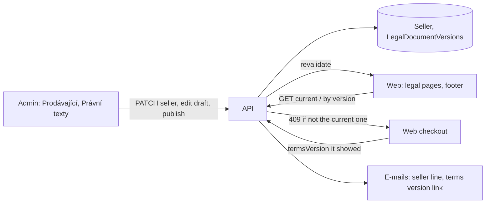

# Legal texts and seller details in the admin

**Ticket:** none yet
**Status:** design — awaiting the owner's word on scope

The owner wants the shop's texts editable in the admin, the terms (obchodní podmínky) first ("dále
co by mělo být konfigurovatelné jsou texty obchodní podmínky atd."). Today they are code:

- the three legal pages (`/obchodni-podminky`, `/ochrana-osobnich-udaju`,
  `/odstoupeni-od-smlouvy`) are Markdown-subset strings in `apps/web/src/content/legal/*.ts`,
  Czech and English, rendered by `components/legal/LegalDocument` with `{{…}}` filled by
  `lib/legal.ts`;
- the seller's details (`SELLER`, still placeholders), `TERMS_VERSION` and `TERMS_EFFECTIVE_FROM`
  are constants in `packages/domain/src/seller.ts`, read by the web (footer, legal pages), the
  checkout (`termsVersion` on every order) and the e-mails (footer `SELLER_LINE`, the confirmation's
  "platných od …").

Unlike the e-mail texts, the terms are a contract: what a customer agreed to must stay findable
exactly as it was, so the design is built around **versions that never change once published**.

## Design

The admin writes, the API owns the rules (what may change, which version is current), the web
only reads. The domain carries what more than one app needs: the Markdown subset's parser and the
placeholder filler, so the admin's preview and the web render the same text the same way.

### Seller details

A single-row entity `Seller` (table `Sellers`): `name`, `ico`, `address`, `email`, `phone`,
`registration`, `vatPayer`, `complete` (the draft notice on the legal pages shows until the admin
marks the details complete). Read by anyone (the footer needs it), PATCHed by the signed-in admin,
never created or deleted (like `EmailTemplate`). Seeded by a migration with today's placeholders.
`SELLER` / `SELLER_LINE` go; the web, the e-mails and the legal placeholders read the row
(`sellerLine(seller)` in the domain). Editing it revalidates the web.

Seller details are not versioned: a corrected address is not a new contract. The bank account stays
in the environment (`BANK_ACCOUNT_*`); it is checkout configuration, not shop text.

### Legal documents with versions

An entity `LegalDocumentVersion` (table `LegalDocumentVersions`):

| field | |
|---|---|
| `document` | `terms` \| `privacy` \| `withdrawal` (`LEGAL_DOCUMENTS`) |
| `version` | `YYYY-MM-DD`, unique per document; what an order stores as `termsVersion` |
| `effectiveFrom` | DATEONLY; the day it applies from (today or later) |
| `body_cs` | the text, the Markdown subset with `{{…}}` |
| `body_en` | optional; the English page shows the Czech text with a note while it is empty |
| `status` | `draft` \| `published` |
| `publishedAt` | set on publishing |

Rules, all in the API:

- **A published version is frozen.** PATCH and DELETE refuse it (409). Only a draft is edited or
  deleted; at most one draft per document.
- **Publishing** is its own action, `POST /api/legal-documents/:id/actions/publish`, signed-in
  admin: checks the text (no unknown placeholder, parses), sets `status`, `publishedAt`, and
  refuses an `effectiveFrom` before today or not after the current version's. It can't be undone,
  so the admin asks first.
- **The current version** of a document is the newest published one with `effectiveFrom` ≤ today
  (Prague time). A version published for a later day takes over on that day by itself.
- **Public reads:** `GET /api/legal-documents/:document/current` and
  `GET /api/legal-documents/:document/versions/:version` (published only); drafts only signed in.

### What changes around them

- **Web:** the legal pages fetch the current version (ISR, revalidated on publish and by the hour,
  so a future version shows on its day). Each version stays reachable at
  `/obchodni-podminky/2026-11-02` (and so on), with a list of earlier versions under the page.
  `content/legal/*.ts` and `lib/legal.ts` are deleted; `LegalDocument` renders the domain parser's
  blocks. An unknown placeholder renders as written (the admin can't publish one) instead of
  throwing.
- **Checkout:** the summary step shows the current terms version; the checkout sends the version
  it showed (`termsVersion`), and the API refuses (409, "Obchodní podmínky se mezitím změnily…") if
  it is no longer current, so nobody agrees to a text they didn't see. `TERMS_VERSION` goes.
- **E-mails:** the confirmation names the version's `effectiveFrom` and links that exact version.
- **Migration** creates both tables and seeds the `Seller` row and version `2026-11-02` of each
  document, published, with today's texts (frozen copies, Czech and English).

### Admin

"Nastavení" gets **Prodávající** (one form) and **Právní texty**: per document, its versions (the
current one marked, a scheduled one dated), "Nová verze" (a draft copied from the current text),
the draft's editor beside a live preview (the domain parser rendered in Vue), and "Zveřejnit" with
the effective date and a confirmation that names what it means ("zákazníci od … souhlasí s touto
verzí; zveřejněnou verzi už nejde změnit").

## Steps

1. Seller details: entity, migration, web / e-mails read the row, admin page.
2. Legal versions in the API and the web: entity, migration with today's texts, routes and publish
   rule, the parser in the domain, web pages and archive URLs, checkout version check, e-mail link.
3. Admin "Právní texty": versions list, draft editor with preview, publish.

Each a PR into `dev`, verified on the test sites; `TERMS_VERSION` keeps working until step 2.

## Open questions for the owner

1. Scope: the legal pages and the seller's details (recommended), or also the website's own texts
   (home page, "o mně", contact), which live in the translation files today?
2. Publishing: with an effective date, today or later (recommended), or always at once?

## Decided
