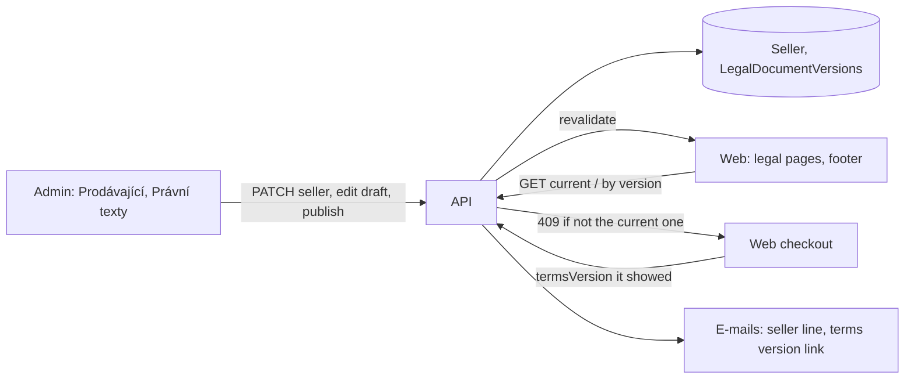

# Legal texts and seller details in the admin

**Ticket:** none yet
**Status:** design — architecture review done, awaiting the owner's word on scope

The owner wants the shop's texts editable in the admin, the terms (obchodní podmínky) first ("dále
co by mělo být konfigurovatelné jsou texty obchodní podmínky atd."). Today they are code:

- the three legal pages (`/obchodni-podminky`, `/ochrana-osobnich-udaju`,
  `/odstoupeni-od-smlouvy`) are Markdown-subset strings in `apps/web/src/content/legal/*.ts`,
  Czech and English, rendered by `components/legal/LegalDocument` with `{{…}}` filled by
  `lib/legal.ts`;
- the seller's details (`SELLER`, still placeholders), `TERMS_VERSION` and `TERMS_EFFECTIVE_FROM`
  are constants in `packages/domain/src/seller.ts`, read by the web (footer, legal pages), the
  checkout (`termsVersion` on every order) and the e-mails (footer `SELLER_LINE`, the confirmation's
  "platných od …").

Unlike the e-mail texts, the terms are a contract: what a customer agreed to must stay findable
exactly as it was, so the design is built around **versions that never change once published**.

## Design

The admin writes, the API owns the rules (what may change, which version is current), the web
only reads. The domain carries what more than one app needs: the Markdown subset's parser and the
placeholder filler, so the admin's preview and the web render the same text the same way.

### Seller details

A single-row entity `Seller` (table `Sellers`): `name`, `ico`, `address`, `email`, `phone`,
`registration`, `complete` (the draft notice on the legal pages shows until the admin marks the
details complete). Read by anyone (the footer needs it), PATCHed by the signed-in admin, never
created or deleted (`signedInEditingOnly`, like `EmailTemplate`). Seeded by a migration with
today's placeholders. `SELLER` / `SELLER_LINE` go; the web, the e-mails and the legal placeholders
read the row (`sellerLine(seller)` in the domain). The seller PATCH joins `changesTheWebsite` in
`web/revalidate-web.ts`. `vatPayer` is left out until something reads it.

The live row is not versioned (a corrected address is not a new contract), but each published
legal version keeps a **snapshot of the seller's values** it was published with, and an archived
version is shown with its snapshot, so it reads exactly as the customer saw it.

The bank account stays in the environment (`BANK_ACCOUNT_*`); it is checkout configuration.

### Legal documents with versions

An entity `LegalDocumentVersion` (table `LegalDocumentVersions`):

| field         |                                                                                                                                               |
| ------------- | --------------------------------------------------------------------------------------------------------------------------------------------- |
| `document`    | `terms` \| `privacy` \| `withdrawal` (`LEGAL_DOCUMENTS`)                                                                                      |
| `version`     | `null` for the draft; on publishing the Prague date `YYYY-MM-DD`, `.2`, `.3` … for a second one that day (fits `termsVersion`, 20 characters) |
| `body_cs`     | the text, the Markdown subset with `{{…}}`                                                                                                    |
| `body_en`     | optional; the English page shows the Czech text with a note while it is empty                                                                 |
| `status`      | `draft` \| `published`, `readOnly`                                                                                                            |
| `publishedAt` | set on publishing, `readOnly`                                                                                                                 |
| `seller`      | JSON snapshot of the seller's values at publishing, `readOnly`                                                                                |

**Publishing takes effect at once** (no scheduled versions): a one-off sale is governed by the
terms in force when the order is placed, so a future date buys nothing but edge cases. The current
version of a document is its newest published one. Only the terms version is stored on an order.

Rules, all in the API (`src/legal/`):

- **Writes go through the plugin's own routes**, not auto CRUD (whose hooks see only the incoming
  data and can't tell a draft from a published row): `POST /api/legal-documents/:document/draft`
  (a draft, copied from the current text when none exists), `PUT …/draft`, `DELETE …/draft`,
  `POST …/draft/publish`. Each runs in one transaction holding a per-document advisory lock
  (`pg_advisory_xact_lock`), so there is one draft per document, a version string is never taken
  twice, and a draft can't be edited while it is published. Auto CRUD stays read-only.
- **A published version is frozen**: no route changes or deletes one; a test proves that a PATCH or
  DELETE through auto CRUD is refused.
- **Publishing checks the text**: no unknown or broken placeholder, it parses, and each document
  keeps what other pages link to (the terms the `{#reklamace}` complaints heading). It can't be
  undone, so the admin asks first.
- **"Today" is Prague's**: one domain function (`pragueDate(now)`, `Intl` with
  `Europe/Prague`) names the version; never `CURRENT_DATE` or the server's zone. Tested at 23:30
  UTC and across the DST change.
- **Public reads:** `GET /api/legal-documents/:document/current` and
  `…/versions/:version` (published only, with the seller snapshot); the draft only signed in.

### What changes around them

- **One placeholder engine:** `fillPlaceholders` / `unknownPlaceholders` / `hasBrokenPlaceholder`
  (today the e-mail templates') take the set of names they know, and the legal texts use them with
  their own names (`sellerName`, `termsPath`, …). An unknown one renders as written.
- **The parser** of the Markdown subset moves from `components/legal/LegalDocument` to the domain
  (pure, blocks out); the web renders the blocks in React, the admin's preview in Vue.
- **Web:** the legal pages fetch the current version (ISR, revalidated on publish and hourly); each
  version also has its own page, `/obchodni-podminky/2026-11-02`, cached for good, with the
  earlier versions listed under the current one. `content/legal/*.ts` and `lib/legal.ts` go.
- **Checkout:** the summary step reads the current terms version live and links **that exact
  version's page**, so what the customer opens is what they agree to; the checkout sends
  `termsVersion`. A version published meanwhile gets a 409 with its own code (`terms_changed`,
  plus the current version), which the web handles apart from "the cart changed": it loads the new
  version, unticks the box and says the terms changed. `TERMS_VERSION` goes.
- **E-mails:** the confirmation names and links the order's own `termsVersion`.
- **Migration** creates both tables, seeds the `Seller` row and version `2026-11-02` of each
  document, published, with today's texts (frozen copies). Test orders placed under the earlier
  test versions (2026-09-28, 2026-11-01) get no archived text; production orders carry none.
- **Deploy order:** the web reads routes the API adds, so the API's part lands (and deploys) in a
  PR before the web starts reading it; until then the web keeps its constants.

### Admin

"Nastavení" gets **Prodávající** (one form) and **Právní texty**: per document, its versions (the
current one marked), "Nová verze" (a draft copied from the current text), the draft's editor beside
a live preview, and "Zveřejnit" with a confirmation that names what it means ("zákazníci od teď
souhlasí s touto verzí; zveřejněnou verzi už nejde změnit").

## Steps

1. One placeholder engine and the Markdown parser in the domain (no behaviour change).
2. Seller details: entity, migration, admin page "Prodávající"; then the web and e-mails read it.
3. Legal versions in the API: entity, migration with today's texts, routes, publish rules, the
   checkout's version check.
4. The web reads them: legal pages, version pages, checkout link and 409 handling, e-mail link.
5. Admin "Právní texty": versions, draft editor with preview, publish.

Each a PR into `dev`, verified on the test sites; the API side of a step deploys before the web
reads it.

## Follow-ups

- The confirmation e-mail only links the terms. Consumer law likely wants them on a durable medium
  (the text itself, e.g. as a plain-text attachment, not just a link); ask whoever checks the
  texts. Once versions are in the API this is cheap.

## Open questions for the owner

1. Scope: the legal pages and the seller's details (recommended), or also the website's own texts
   (home page, "o mně", contact), which live in the translation files today?

## Decided
