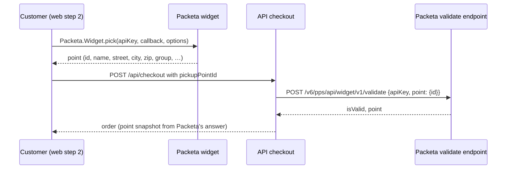

# Zásilkovna pickup points at checkout

**Ticket:** none yet
**Status:** active — steps 1–2 (API, admin, web) in review

The owner (2026-11-01): "krok zásilkovna má chybu — musí si dotyčný vybrat místo k vyzvednutí v
blízkosti bydliště" and "projdi si i co musíme splnit u zásilkovny, musíme i přidat jejich banner
třeba do footeru". Today `zasilkovna` is a plain `delivery` method: the customer picks it in step 2
and the parcel has nowhere to go, because Zásilkovna delivers to a pickup point (výdejní místo or
Z-BOX) the customer chooses, not to the address from step 1. The order has to carry that point, and
the artist has to see it when she hands the parcel over.

Builds on the shipping methods from
[checkout and e-mail settings](../2026-11-01-checkout-and-email-settings/README.md); the legal
texts are being moved into the admin by [legal texts](../2026-11-01-legal-texts/README.md).

The boundaries: the widget runs in the customer's browser, so its answer can be faked; the API
asks Packeta itself and stores what Packeta says, not what the browser sent.

## What Packeta asks of an e-shop

Read 2026-11-01 from Packeta's widget v6 manual (`old.docs.packeta.com/01-pickup-point-selection/02-widget-v6.html`),
"Jak začít" (`zasilkovna.cz/jak-zacit`) and the e-shop FAQ (`zasilkovna.cz/blog/caste-dotazy-e-shopu`):

- **An account** at `client.packeta.com` (free, approved within 3 working days), billing details and
  the sender filled in, the terms (VOP) accepted. Invoiced weekly. No minimum volume; a courier
  pickup only from ~12 parcels a day, otherwise the parcel is dropped off at a point.
- **The widget** needs the account's **API key** (16 characters, public, an account identifier; not
  the API password). External points and other countries are switched on in the client section.
- **Validate the chosen point on the server** (the selection happens on the customer's device and
  can be bypassed): `POST https://widget.packeta.com/v6/pps/api/widget/v1/validate`.
- **Unavailable points** (`error`: vacation, full, closing) must not be selectable; the widget does
  this itself, the validation catches the rest.
- **Each parcel** is entered in the client section (by hand, import or API) with the point id; the
  label is printed from "Podané zásilky", one per box, barcode uncovered. Parcel number format
  `Z 123 4567 890` (tracking as today).
- **Limits:** 5 kg, longest side 60 cm, sides together 120 cm (oversize up to 15 kg / 120 / 150 cm);
  insured up to 20 000 CZK. Larger ceramics need Česká pošta.
- **Logo / banner:** not required. Packeta recommends a homepage banner (`bannery_eshop_CZ.zip`), a
  pop-up, a subpage about Zásilkovna, and listing it on Heureka / Zboží. The owner wants it in the
  footer (below).

## The method says it needs a point

A new optional field on `ShippingMethod`: `pickupNetwork` (`ENUM ['packeta']`, empty = none). It is
separate from `kind`, which keeps deciding the workflow: a Zásilkovna parcel is still shipped and
tracked (`delivery`), only its destination is a point. "Zásilkovna na adresu" could then be added in
the admin as an ordinary delivery method, and another network (Balíkovna, PPL) would be one more
enum value and one more widget.

- Admin, Doprava dialog: a select "Výdejní místa" (Žádná / Zásilkovna).
- The migration sets `pickupNetwork = 'packeta'` on the seeded `zasilkovna` row.

## The order stores the point

New order columns, snapshots like `shippingName`, so the order never changes:

| field                | what                                                                |
| -------------------- | ------------------------------------------------------------------- |
| `pickupPointId`      | Packeta's point id; what the parcel is addressed to in Packeta      |
| `pickupPointName`    | e.g. "Praha 4, Budějovická 1667/64 (Albert)"                        |
| `pickupPointAddress` | street, zip and city of the point, one line                         |
| `pickupPointType`    | `box` (Z-BOX) or `point` (staffed) — the e-mail says how to collect |

The checkout request carries only `pickupPointId` (`customerFields`, optional there). The API:

- for a method with `pickupNetwork`: requires `pickupPointId` (digits) else **400**; asks Packeta's
  validate endpoint and stores the name and address **from Packeta's answer**; a point Packeta
  calls invalid is a **400** on `pickupPointId` ("choose another point").
- if Packeta can't be reached (timeout ~5 s, 5xx): **503**, "try again in a moment" — no order goes
  to a point nobody checked. The cart and the choice stay in the browser.
- for any other method: ignores `pickupPointId`, so a point left over from an abandoned choice
  never sticks.

The validation runs before the transaction that locks the stock, so a slow Packeta never holds the
locks. `PACKETA_API_KEY` in the API's environment (Railway `test` and `production`). It is checked at
checkout, not at start: a missing key answers 503 for a method with `pickupNetwork` alone, so the
rest of the shop works.

The home address (step 1) stays required: it is the invoice address, and asking for it keeps the
checkout the same for every method.

## Web: choosing the point

- Step 2: choosing a method with `pickupNetwork` shows **"Vybrat výdejní místo"** under it. After a
  choice, a small card with the point's name, address and a Z-BOX mark, and **"Změnit"**. "Další"
  stays disabled until a point is chosen. Switching to another method clears it.
- `https://widget.packeta.com/v6/www/js/library.js` loads only when the button is first pressed (no
  third-party script on other pages); a failure shows "Výběr výdejního místa se nepodařilo načíst,
  zkuste to znovu". Modal mode (tested on a phone).
- Options: `language` from the locale (`cs` / `en`), `country: 'cz'`, `vendors` Czech points + Z-BOX
  (`{ country: 'cz' }`, `{ country: 'cz', group: 'zbox' }`), `appIdentity: 'klotilda-<version>'`.
- The point is part of `CheckoutData`; step 4 shows "Výdejní místo: …" (the confirmation e-mail
  repeats it). A 400
  on `pickupPointId` sends the customer back to step 2 with the message.
- `NEXT_PUBLIC_PACKETA_API_KEY` in Vercel (`klotilda-frontend`, both environments). Without it the
  method is shown as unavailable instead of breaking the checkout.
- `next.config.ts`: `Permissions-Policy` forbids geolocation everywhere (`geolocation=()`), which
  kills the widget's "near me"; allow it for the widget
  (`geolocation=(self "https://widget.packeta.com")`). The CSP has no `script-src` / `frame-src`.

## Zásilkovna in the footer

A small "Doručujeme se Zásilkovnou" linking to `zasilkovna.cz`, beside the footer's tagline; the
official logo from Packeta's banner pack takes the words' place once the owner provides the pack. Shown only with the shop on (`SHOP_ENABLED`) — the
footer cannot know which methods are active without a request on every page, and Zásilkovna is
offered whenever the shop is. The logo is a static file in `apps/web/public/` (SVG if the pack has
one), `next/image`, muted to the footer's stone tones on hover only if the brand rules allow it —
the pack's rules decide; otherwise shown as delivered.

## Legal texts

The texts are `LegalDocumentVersion` rows (legal-texts step 3): a change is a new version, drafted
by the legal-texts work and published by the owner. The additions for that draft:

> **Language and purpose.** Customer-facing text for the next version of the terms and the privacy
> policy, Czech and English, to be pasted into the draft by the legal-texts work; not published.

**Terms, section "5. Dodání" / "5. Delivery"** — a new paragraph after the first one:

> Při dopravě Zásilkovnou doručí dopravce zboží na výdejní místo nebo do Z-BOXu, které kupující
> zvolí v pokladně. Jakmile zásilka dorazí, pošle Zásilkovna kupujícímu SMS a e-mail s heslem pro
> vyzvednutí (u Z-BOXu s kódem k otevření schránky). Zásilku je třeba vyzvednout do 7 dnů; lhůtu lze
> v aplikaci Zásilkovny prodloužit. Nevyzvednutou zásilku vrátí dopravce prodávající; prodávající
> pak kupujícímu vrátí kupní cenu bez nákladů na dopravu, nebo mu zboží po zaplacení nového
> poštovného pošle znovu.
>
> With Zásilkovna (Packeta) the carrier delivers to the pickup point or Z-BOX the buyer chose at
> checkout. When the parcel arrives, Zásilkovna sends the buyer a text message and an e-mail with
> the pickup code (for a Z-BOX, the code that opens the box). The parcel must be collected within
> 7 days; Zásilkovna's app can extend this. An uncollected parcel goes back to the seller, who then
> refunds the price of the goods without the shipping, or sends the goods again once the new
> shipping is paid.

**Privacy, the carriers' paragraph** — replaces "Dopravcům (Zásilkovna s.r.o., Česká pošta, s.p.)
předáváme jméno, doručovací adresu, e-mail a telefon, aby vám mohli zásilku doručit." (and its
English twin):

> Dopravcům předáváme údaje potřebné k doručení: Zásilkovně s.r.o. jméno, e-mail, telefon a
> zvolené výdejní místo, České poště, s.p. jméno, doručovací adresu, e-mail a telefon. Výdejní místo
> vybíráte na mapě Zásilkovny, kterou web načte až ve chvíli, kdy ji otevřete; mapa si ve vašem
> prohlížeči pamatuje naposledy zvolené místo (cookies Zásilkovny) a o vaši polohu požádá, jen
> když zvolíte hledání v okolí.
>
> We pass the carriers what delivery needs: Zásilkovna s.r.o. your name, e-mail, phone and the
> chosen pickup point; Česká pošta, s.p. your name, delivery address, e-mail and phone. You choose
> the pickup point on Zásilkovna's map, which the site loads only when you open it; the map
> remembers the last chosen point in your browser (Zásilkovna's cookies) and asks for your
> location only if you search near you.

The phone is optional at checkout; Zásilkovna then notifies by e-mail only.

## E-mails

- Order received (customer) and new order (artist): a "Výdejní místo" row (name, address) instead of
  "Doručení na adresu" when the order has a point.
- Shipped: the same row, and for a Z-BOX one line that the code comes by SMS / in the app.
- A new placeholder `{{vydejni_misto}}` for the confirmation and shipped texts (empty without a
  point). The admin preview gets a sample point.

## Admin

- Order detail: a "Výdejní místo" block next to the address: name, address, Z-BOX mark, the id with
  a copy button (what she enters in Packeta's client section). "Kopírovat adresu" copies the
  name, the point and its id instead of the home address.
- Orders list: the point's name under "Zásilkovna" (small, secondary), on the cards in brackets.

## Migration

`<date>-pickup-points`: `ShippingMethods.pickupNetwork`, set for `zasilkovna`; the four order
columns. Old Zásilkovna orders keep no point (nothing to backfill). `migrations.integration.test.ts`
as usual.

## Steps

1. API + domain: fields, migration, validation against Packeta (mocked in tests), e-mails, admin
   (Doprava switch, order detail).
2. Web: widget in step 2, summary, error handling, `Permissions-Policy`, footer line (the logo once
   the banner pack arrives).
3. Legal texts: the paragraphs above go into the next drafted version (legal-texts work); the owner
   publishes it.

Steps 1 and 2 reach `dev` together: the migration turns pickup points on for `zasilkovna`, so with
the API alone (or without `PACKETA_API_KEY` on Railway) the test site can't order Zásilkovna — a
400 on a field it doesn't show, or a 503. The other methods are unaffected. On production the shop
is off; there the key must be set before it goes on.

The legal-texts work also touches the checkout (terms version, step 4); these steps branch from the
latest `dev` and keep their checkout edits small.

## What the owner does

1. Register the shop at `client.packeta.com` (if not yet): billing details, the sender, VOP.
2. From the client section send: the **API key** (16 characters) — it goes into Railway
   (`PACKETA_API_KEY`) and Vercel (`NEXT_PUBLIC_PACKETA_API_KEY`), test first.
3. Download the banner pack (`bannery_eshop_CZ.zip`, linked from `zasilkovna.cz/jak-zacit`) and
   upload it, or let the logo be taken from it.
4. Set Zásilkovna's price in the admin (Doprava).
5. Per order afterwards: enter the parcel in the client section with the point id from the admin,
   print the label, drop it off at any point, then "Odeslat" in the admin with the `Z …` number.

## Not in this plan (follow-ups)

- Creating the parcel in Packeta from the admin (API password, `createPacket`, label PDF, number
  filled in automatically). Worth it once orders are regular.
- A `/zasilkovna` info page or a homepage banner (Packeta's other recommendations).

## Decided

- 2026-11-01: Z-BOXes yes, Slovakia no; the owner sets Zásilkovna's price in the admin. The
  implementation goes ahead before the Packeta account exists; the key is added later.
- 2026-11-01 (implementation): the method's switch is a boolean in the admin ("Na výdejní místo
  Zásilkovny") over `pickupNetwork`, as there is one network; a `pickup` method never has one (the
  API ignores it there). A 503 answer carries be-core's generic message (it replaces every 5xx message), so the web words it itself.
