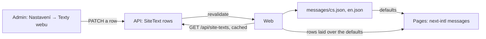

# The website's own texts in the admin

**Ticket:** none yet
**Status:** shipped (2026-11-01)

Step 6 of [the legal texts plan](../2026-11-01-legal-texts/README.md): the owner asked for "all of
it", which includes the website's own wording: the home page's subtitle, "O mně", the gallery's and
the shop's lines, the contact details and the description search engines show. Today these are the
web's translation files (`apps/web/messages/{cs,en}.json`), so changing a sentence means a deploy.

## Design

The texts stay **next-intl messages**: the web lays the rows over its translation files when it
loads the messages (`src/i18n/request.ts`), so the sections keep their `useTranslations` and every
other string keeps coming from the files. The one component change: the contact's Instagram link
is built from the handle instead of being written into `ContactSection`. The API only stores and serves rows; the admin edits them.

- **Entity `SiteText`** (table `SiteTexts`): `key` (one of `SITE_TEXT_KEYS`, the message path it
  replaces, e.g. `home.about.bio1`; fixed, unique, `readOnly`), `text_cs` (empty leaves the text
  out, as the Czech second paragraph about the artist is today) and `text_en` (empty shows the
  Czech text, so an e-mail address or a handle is written once). Anyone reads, the signed-in admin
  PATCHes (`signedInEditingOnly`, like the e-mail texts); rows are never created or deleted through
  the API. Seeded by a migration with today's texts of both files, frozen copies.
- **Which texts:** what the artist words, not the site's chrome: the hero's subtitle, "O mně"
  (title and two paragraphs), the gallery's subtitle, the shop teaser's title and line, the contact
  line, e-mail and Instagram, and the page description (`metadata.description`). Button labels,
  navigation and the shop's flow stay in the files.
- **Web:** `loadSiteTexts()` reads the rows through `unstable_cache` (tag `site-texts`, hourly), so
  a page render costs no extra request; `POST /api/revalidate` also revalidates the tag, and the
  API calls it after a PATCH of `/api/site-texts` (`changesTheWebsite`). Loaded like the other
  static data (`loadStaticData`): without an API the files alone; a failed read is rethrown, so
  Next keeps the last good page rather than caching one with the defaults. The Instagram link is
  built from the handle (`@name` → `https://instagram.com/name`).
- **Literal text:** next-intl formats every message as ICU, so the overlay escapes what the admin
  typed (`escapeMessage`: quotes doubled, runs of `{}<` quoted; a lone `>` needs nothing, next-intl
  leaves a message without `{` or `<` unparsed); a brace shows as a brace instead of the
  message's key. The contact e-mail and Instagram (`UNTRANSLATED_SITE_TEXTS`) read the same in
  both languages: their English text is never used, and the admin shows no field for it. The
  Instagram link takes a handle or a profile's address.
- **Costs:** every page's render now reads the texts (cached), as the home page reads the gallery:
  with the API down a first render of a page fails and a regeneration keeps the last good one.
  Until production sets `WEB_REVALIDATE_URL`, an edit there shows within the cache's hour plus the
  page's own `revalidate`.
- **Two addresses:** the contact e-mail is where visitors write; the seller's e-mail (Prodávající)
  is the legal contact the terms name. They may differ, so they are edited apart.
- **Tests:** the domain's overlay (a copy, only existing messages, literal text, the English
  fallback), the API's rows (one per key, each a message of both translation files seeded with its
  text, edited only by the admin, never added or removed) and the revalidation of a PATCH.
- **Admin:** "Texty webu" under Nastavení: one form, the texts grouped by section of the home
  page, Czech and English side by side, saving only the rows that changed.

## Follow-ups

- The web reads the texts with no timeout of its own: an API that hangs holds a render until the
  platform's limit (the gallery's read has the same exposure).
- Locally without `REVALIDATE_SECRET` an edit shows only after the cache's hour.
- A save that fails half way shows one error toast; the rows saved stay saved and reload.
- The contact e-mail is not checked to be an address.

## Steps

1. Entity, migration, revalidation, the web's overlay, the admin page. One PR into `dev`.

## Decided

- 2026-11-01: an empty English text shows the Czech one, as the legal texts do: a changed e-mail
  address then shows in both languages, and the seeded rows carry today's English, so the English
  site stays English.
